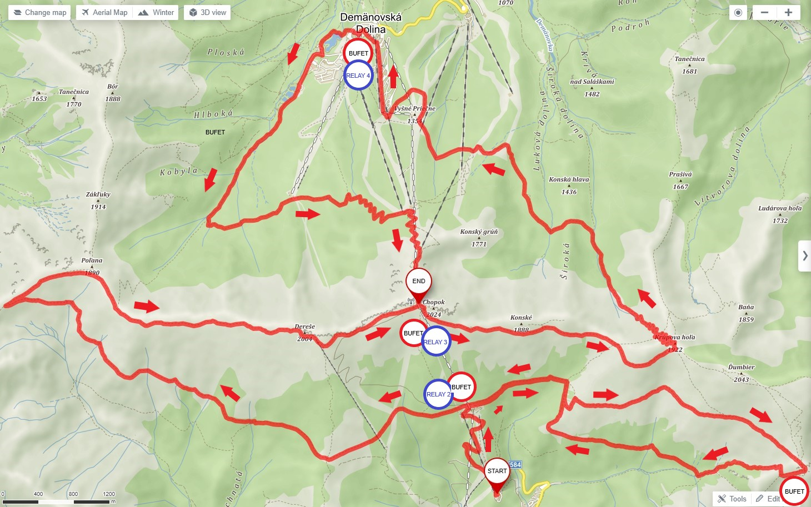
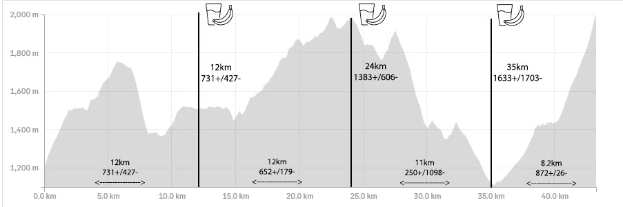
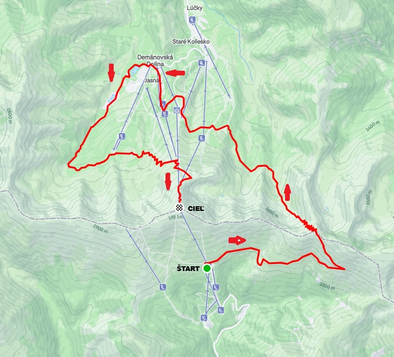
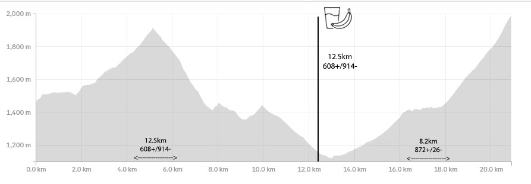
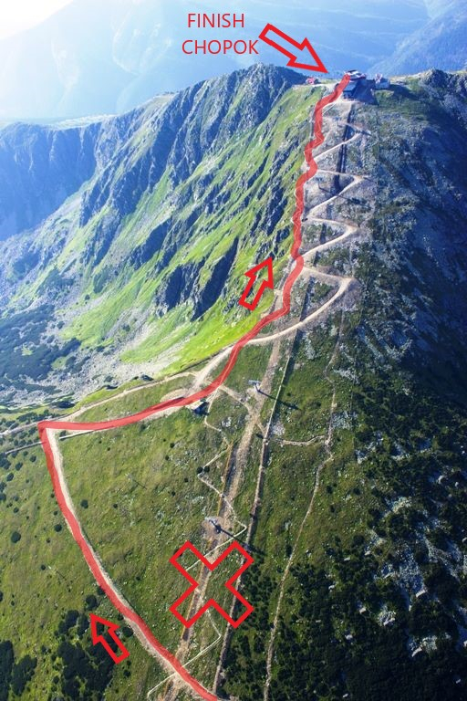

### **Course**

#### Skymarathon Chopok 43km/2600m
The main course takes you across the entire area surrounding Chopok and showcases the most beautiful views the Low Tatras have to offer.

The race starts at Hotel Srdiečko, where your first climb takes you past the Kosodrevina mountain hotel up to the Milan Rastislav Štefánik mountain hut (aid station 1). From there, a short, slightly technical descent brings you back to the main trail (Magistrála). You then pass Kosodrevina hotel once more (aid station 2) and follow the blue trail up a gentle, rolling climb to Krížske sedlo, where the finest views open up as you join the main ridge of the Low Tatras. The ridge section from Krížske sedlo to Chopok is relatively non-technical and climbs gently all the way. You ascend up to Kamenná Chata pod Chopkom (aid station 3), from where the remaining rolling ridge section leads you to Široké sedlo. 

Please note that on sunny weekend days, the main ridge of the Low Tatras (especially around Chopok) is a very popular hiking destination. Please respect other people on the trails and always alert hikers when passing them. 

From Široké sedlo, you face the primary descent, starting with technical switchbacks that transition into a steep, granite-paved downhill. This section is quite technical and can be slightly dangerous in wet weather, so take extra care here. Next is a very short uphill that leads onto a wide cycle path, descending gently all the way to Demänovská dolina (aid station 4). 
From Demänovská dolina, all that remains is a solid vertical kilometer back up to Chopok. You will first climb gently through the hotel area, then through the forest. Just below Luková (approx. 450 meters of elevation gain to the finish), the slope steepens considerably to test whatever energy you have left until the finish line. 

[DOWNLOAD CHOPOK SKYMARATHON GPX ROUTE](http://chopok.leitnersport.sk/user/pages/02.info/SkyMarathonChopok-2024.gpx)

#### Skyrace Chopok 23km/1400m

The shorter course starts at the Kosodrevina cable car station. Like the main route, it initially takes you toward Štefánikova hut, but turns left before reaching it toward the main ridge of the Low Tatras. This brings you to Široké sedlo, from where the route continues identically to the main course. 

[DOWNLOAD CHOPOK SKYRACE GPX ROUTE](http://chopok.leitnersport.sk/user/pages/02.info/SkyRaceChopok.gpx)

Both courses finish at the end as follows: 

Everything will be properly marked, we strive to mark the course so clearly that "even a blind person wouldn't get lost." However, we strongly recommend having the GPX file downloaded on your watch. 

#### **COURSE RECORDS:**
**Original route valid until 2022**  

*SKYMARATHON 42 km - men - Peter Fraňo / 2018 - 4:16:10  

*SKYMARATHON 42 km - women - Vanda Jenejová / 2018 - 5:42:51  

*SKYMARATHON 42 km - relay - TULIKIVI - / 2018 - 4:16:04  

 
**Route change SINCE 2023**  

SKYMARATHON 43 km - men - Patrik Milata / 2024 - 4:28:20  

SKYMARATHON 43 km - women - Lenka Ploščicová / 2023 - 5:22:03  

SKYMARATHON 43 km - relay - Tatra Climbing Boyz / 2024 - 4:46:47  

SKYRACE 21 km - men - 2025 - Peter Fraňo - / 1:49:14 /

SKYRACE 21 km - women - 2025 - Ivana Líšková / 2:22:20 /

**CASH PRIZE OF 500 EUR FOR BREAKING THE COURSE RECORD ON SKYMARATHON 43 km **  

**SKYMARATHON 43 km - relay - on the old route, the record belonged to TULIKIVI / 2018 - 4:16:04 / - new target record set at 4:25:00. **

**CASH PRIZE OF 500 EUR FOR BREAKING THE COURSE RECORD ON SKYRACE 21 km **